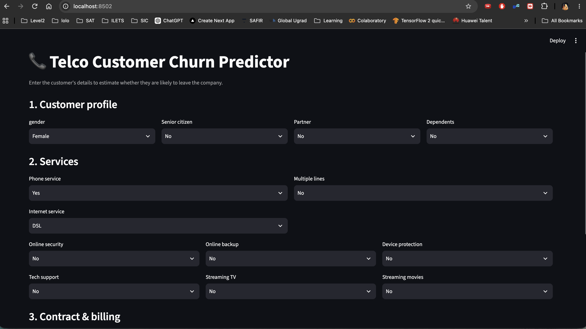
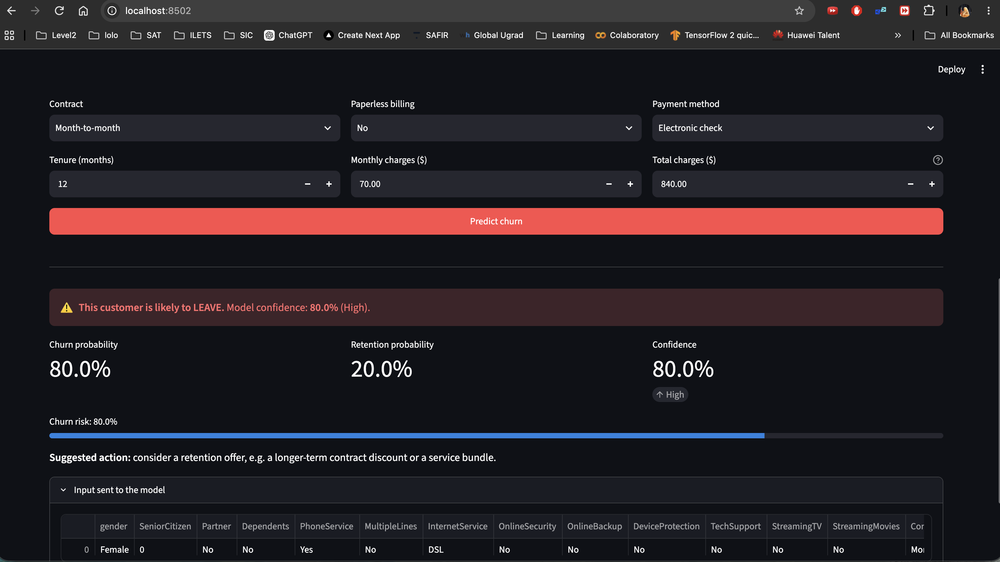

# Telco Customer Churn Predictor

A machine-learning project that predicts whether a telecom customer is about to **leave (churn)** or **stay**, plus a Streamlit web app that lets a customer-service agent get a prediction, with a confidence level, in a few clicks.

## Screenshots

**1. Customer input form**: the agent enters the customer's profile, services, contract and billing details.



**2. Prediction result**: the app shows whether the customer is likely to leave or stay, with the confidence level, churn and retention probabilities, and a suggested action.



## Contents

1. [Overview](#overview)
2. [Project structure](#project-structure)
3. [Setup](#setup)
4. [Data](#data)
5. [Modelling workflow (notebook)](#modelling-workflow-notebook)
6. [Model results](#model-results)
7. [Saved artifacts](#saved-artifacts)
8. [Streamlit app](#streamlit-app)
9. [Confidence level](#confidence-level)
10. [Retraining](#retraining)
11. [Known limitations](#known-limitations)

## Overview

| Item | Value |
|---|---|
| Task | Binary classification (`Churn`: No / Yes) |
| Dataset | OpenML `telco-customer-churn` (7,043 customers, 19 features) |
| Imbalance handling | SMOTE oversampling |
| Final model | `RandomForestClassifier` tuned with `GridSearchCV` (scoring = F1, 5-fold CV) |
| Serving | Streamlit app ([app.py](app.py)) loading `models/churn_pipeline.joblib` |

## Project structure

```
Telco_customer_churn/
├── app.py                                   # Streamlit UI
├── ml-pipeline-gridsearch-business.ipynb    # EDA, modelling, grid search, model export
├── models/
│   ├── churn_pipeline.joblib                # Final fitted sklearn Pipeline (best GridSearch estimator)
│   └── metadata.json                        # Feature order, category mappings, best params
├── images/                                  # App screenshots used in this README
├── requirements.txt                         # Pinned dependencies
├── README.md
└── .venv/                                   # Local virtual environment (not committed)
```

## Setup

Requires Python 3.11 (the environment was built with 3.11; other 3.10+ versions should work).

```bash
python3.11 -m venv .venv
source .venv/bin/activate
pip install -r requirements.txt
```

Use pandas `<3` (pinned to 2.3.3). pandas 3 changes string dtypes, which breaks the notebook's `select_dtypes('object')` step.

To use the environment from Jupyter / VS Code, register the kernel:

```bash
python -m ipykernel install --user --name telco-churn --display-name "Python 3 (telco .venv)"
```

## Data

Loaded in the notebook with `fetch_openml(name='telco-customer-churn')` (needs internet on first run).

| Group | Columns |
|---|---|
| Demographics | `gender`, `SeniorCitizen`, `Partner`, `Dependents` |
| Phone / internet services | `PhoneService`, `MultipleLines`, `InternetService`, `OnlineSecurity`, `OnlineBackup`, `DeviceProtection`, `TechSupport`, `StreamingTV`, `StreamingMovies` |
| Account | `Contract`, `PaperlessBilling`, `PaymentMethod`, `tenure`, `MonthlyCharges`, `TotalCharges` |
| Target | `Churn` (≈26.5 % of customers churn, so the classes are imbalanced) |

Cleaning steps:

- `TotalCharges` is converted to numeric (blank strings become `NaN`) and the missing values are filled with the mean.
- Text columns and `SeniorCitizen` are cast to `category`.
- The target is encoded with `LabelEncoder` (`No` → 0, `Yes` → 1).

## Modelling workflow (notebook)

[ml-pipeline-gridsearch-business.ipynb](ml-pipeline-gridsearch-business.ipynb) runs top to bottom and contains:

1. **Baseline**: preprocessing `ColumnTransformer` (numeric: mean imputation + `StandardScaler`; categorical: mode imputation + `OneHotEncoder`) followed by `BernoulliNB`.
2. **SMOTE** (business-class task): same preprocessing with SMOTE (`imblearn` pipeline) and `BernoulliNB`.
3. **Label encoding + SMOTE on the full data**: categorical columns are label-encoded, then the dataset is oversampled to a balanced set and split 75 / 25 (`random_state=42`).
4. **RandomForest**: numeric: median imputation + scaling; categorical: mode imputation + `TargetEncoder`.
5. **GridSearchCV** over the RandomForest pipeline:
   - `n_estimators`: 50, 100, 200
   - `max_depth`: 10, 20, None
   - `min_samples_split`: 2, 5, 10
   - `max_features`: sqrt, log2, None
   - Best: `n_estimators=200`, `max_depth=None`, `max_features='sqrt'`, `min_samples_split=2`
6. **LinearSVC + SMOTE** pipeline for comparison.
7. **Export**: the best estimator and its metadata are saved to `models/`.

## Model results

Hold-out test metrics from the notebook (weighted averages, test split of the SMOTE-balanced data unless noted):

| Model | Accuracy | F1 (churn class) |
|---|---|---|
| BernoulliNB baseline (original, imbalanced data) | 0.73 | 0.62 |
| BernoulliNB + SMOTE | 0.78 | 0.79 |
| RandomForest (50 trees, default) | 0.84 | 0.84 |
| **RandomForest + GridSearch (final)** | **0.84** | **0.84** |
| LinearSVC + SMOTE | 0.83 | 0.82 |

See [Known limitations](#known-limitations) before trusting these figures as real-world performance.

## Saved artifacts

Created by the last cell of the notebook.

- **`models/churn_pipeline.joblib`**: a scikit-learn `Pipeline` (`preprocessor` → `classifier`). It expects a DataFrame with the 19 feature columns in `feature_columns` order.
- **`models/metadata.json`**:
  - `feature_columns`: required column order
  - `numerical_columns` / `categorical_columns`
  - `label_mappings`: for every categorical column, the list of its values. **The integer the model expects is the value's index in this list**, which reproduces the notebook's `LabelEncoder`.
  - `target_classes`: `["No", "Yes"]` (index 0 / 1)
  - `best_params`: grid-search winner

> **Important:** the pipeline was trained on label-encoded categoricals, so any inference code must convert categories to integers using `label_mappings` first. [app.py](app.py) does this in `encode()`. Category strings from OpenML contain literal quotes (for example `'Two year'`, `'No internet service'`); the app strips them only for display.

Load it yourself:

```python
import joblib, json, pandas as pd

model = joblib.load("models/churn_pipeline.joblib")
meta = json.load(open("models/metadata.json"))

row = {...}  # raw category values + numeric values for the 19 features
X = pd.DataFrame([{
    c: meta["label_mappings"][c].index(row[c]) if c in meta["label_mappings"] else row[c]
    for c in meta["feature_columns"]
}])
churn_probability = model.predict_proba(X)[0, 1]
```

## Streamlit app

```bash
source .venv/bin/activate
streamlit run app.py
```

Then open <http://localhost:8501>.

How an agent uses it:

1. Fill in the **Customer profile**, **Services** and **Contract & billing** sections.
2. Click **Predict churn**.
3. Read the result banner:
   - red **"likely to LEAVE"** or green **"likely to STAY"**, each with the model confidence and its band;
   - metrics for churn probability, retention probability and confidence;
   - a churn-risk bar, and a suggested retention action when the customer is likely to leave.

Built-in guard rails:

- If *Phone service* = No, *Multiple lines* is locked to "No phone service".
- If *Internet service* = No, all six internet add-ons are locked to "No internet service".
- Dropdown options come from `metadata.json`, so they always match what the model was trained on.

If the model files are missing, the app shows an error explaining that the notebook must be run first.

## Confidence level

The confidence shown with each result is the model's probability for the **predicted** class:

```
churn_probability = predict_proba(X)[churn]
prediction        = LEAVE if churn_probability >= 0.5 else STAY
confidence        = max(churn_probability, 1 - churn_probability)
```

| Confidence | Band | Meaning |
|---|---|---|
| ≥ 80 % | High | Strong signal |
| 65 – 80 % | Moderate | Reasonable signal |
| < 65 % | Low | Close to a coin flip; the app adds a warning |

It is the RandomForest's vote share, not a calibrated probability, so treat it as a ranking of certainty rather than an exact likelihood.

## Retraining

1. Activate `.venv` and open the notebook with the `telco-churn` kernel.
2. Run all cells. The grid search (243 candidates × 5 folds) takes a few minutes.
3. The final cell overwrites `models/churn_pipeline.joblib` and `models/metadata.json`.
4. Restart the Streamlit app.

Headless run:

```bash
jupyter nbconvert --to notebook --execute --inplace ml-pipeline-gridsearch-business.ipynb
```

Keep scikit-learn at the same version for training and serving; joblib files are not guaranteed to load across versions.

## Known limitations

- **Optimistic metrics.** In the notebook SMOTE is applied to the *whole* dataset *before* the train/test split, so the test set contains synthetic samples interpolated from training rows. The 0.84 scores are therefore inflated, and the app can show very high confidence (often > 90 %) for ordinary customers. For an honest estimate, split first, then apply SMOTE only to the training data (for example inside an `imblearn` pipeline in the grid search) and evaluate on untouched real customers.
- **`TargetEncoder` has no effect.** Categoricals are already integers when they reach it, so it passes them through. The forest effectively treats them as ordinal numbers.
- **Not calibrated.** See [Confidence level](#confidence-level).
- **Predictions are decision support**, not a replacement for agent judgement. Use them to prioritise retention outreach.
